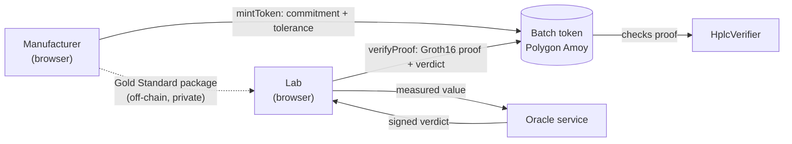

# TraceRx

Reagent batch tracking and verification on Polygon. Blockchain mini project.

Each reagent batch is minted as an ERC-721 token and moves through five on-chain states: `MINTED → IN_TRANSIT → RECEIVED → VERIFIED → CONSUMED`. The smart contract decides who may take each step and in what order. A batch becomes `VERIFIED` only when the receiving lab submits:

- a **zero-knowledge proof** (Groth16) that its HPLC scan matches the manufacturer's reference fingerprint, which was committed on-chain at mint and is never revealed, and
- a verdict **signed by an oracle key** that the contract recognises.

Users sign in with email or Google and pay no gas: every action is an ERC-4337 UserOperation sponsored by a paymaster.

## Reference paper

M. Dashtizadeh, F. Meskaran and D. Tan, "A Secure Blockchain-based Pharmaceutical Supply Chain Management System: Traceability and Detection of Counterfeit Covid-19 Vaccines," *2022 IEEE 2nd Mysore Sub Section International Conference (MysuruCon)*, 2022. [doi:10.1109/MysuruCon55714.2022.9972646](https://doi.org/10.1109/MysuruCon55714.2022.9972646)

The paper proposes a permissioned ledger on which only trusted parties record each hand-over of a drug. TraceRx applies the same idea to lab reagents and adds two things the paper leaves open: custody rules enforced by a smart contract instead of by the application, and a zero-knowledge check that the delivered batch matches what the manufacturer made.

| | Paper | TraceRx |
|---|---|---|
| Ledger | Permissioned blockchain | Public chain (Polygon Amoy) with role-gated writes |
| Who can write | Trusted supply-chain parties | Addresses holding `MANUFACTURER_ROLE` or `LAB_ROLE` |
| Traceability | Transactions recorded per hand-over | ERC-721 token per batch, five enforced states, events |
| Counterfeit detection | Compare the product's record with the ledger | Zero-knowledge proof against an on-chain commitment |
| Data privacy | Restricted network membership | Only a hash of the fingerprint is on-chain |

## Contracts (Polygon Amoy testnet)

| Contract | Address |
|---|---|
| Batch token (`BioToken.sol`, ERC-721, symbol `BIO`) | [`0x59B06aE32e732bb3D91b0F301af6791A0C98b202`](https://amoy.polygonscan.com/address/0x59B06aE32e732bb3D91b0F301af6791A0C98b202) |
| Proof verifier (`HplcVerifier.sol`, Groth16) | [`0xA44699310aE4599cF43C1dBe68B227f3cb4E16DA`](https://amoy.polygonscan.com/address/0xA44699310aE4599cF43C1dBe68B227f3cb4E16DA) |

The token contract keeps the name `BioToken` in its source and on-chain. Identifiers that the deployed contract or the API depend on (the contract name, the oracle message `"BioToken AI verdict: GENUINE"`, the role-registration message) are unchanged, so the app works against this deployment as is.

## How it works



| Step | Call | Who | Rule the contract enforces |
|---|---|---|---|
| 1 | `mintToken` | Manufacturer | Caller has `MANUFACTURER_ROLE`; the commitment is a valid field element; expiry is in the future |
| 2 | `transferCustody` | Manufacturer | Caller holds the token; the recipient has `LAB_ROLE`; state is `MINTED` |
| 3 | `confirmReceipt` | Lab | Caller has `LAB_ROLE` and holds the token; state is `IN_TRANSIT` |
| 4 | `verifyProof` | Lab | Not expired; the oracle signature is valid; the proof verifies against the commitment, tolerance and token id the contract stored itself |
| 5 | `consumeToken` | Lab | Caller holds the token; state is `VERIFIED` |

Ordinary ERC-721 transfers are disabled, so a batch can only change hands through `transferCustody`.

The raw lab scan and the reference fingerprint never leave the browser. Only a Poseidon hash of the fingerprint (with a random salt) is stored on-chain.

## Tech stack

| Layer | Technologies |
|---|---|
| Smart contracts | Solidity 0.8.28, OpenZeppelin (ERC-721, AccessControl, ECDSA), Hardhat |
| Zero-knowledge | Circom 2, circomlib (Poseidon, comparators), snarkjs Groth16 |
| Gasless transactions | ERC-4337 smart accounts, Pimlico bundler and paymaster, Privy login |
| Web app | React 19, Vite, viem, ethers v6 |
| Oracle service | Python, FastAPI, web3.py |
| Network | Polygon Amoy (chain id 80002) |

## Repository structure

```
contracts/      Batch token (ERC-721 + roles + verification) and the generated Groth16 verifier
circuits/       fingerprint.circom, compiled circuit and trusted-setup files (see circuits/SETUP.md)
frontend/       React + Vite web app (login, smart accounts, in-browser proving)
ai/             Oracle service (FastAPI): signs verdicts, registers roles
samples/hplc/   Sample HPLC files for the Mint and Lab pages, with expected results
scripts/        Contract deployment, role grants, local end-to-end run
test/           Hardhat tests (lifecycle, access control, real Groth16 proofs)
deployments/    Deployed addresses + ABI (amoy.json), read by the app and the service
docs/           System verification report, deployment guide, records of live runs
```

## Run locally

Needs Node.js 20.19 or later and Python 3.11 or later.

```bash
git clone https://github.com/potata1008/SME.git
cd SME

# 1. Install
npm install
cd frontend && npm install && cd ..
python -m venv .venv
.venv/Scripts/pip install -r requirements.txt      # macOS/Linux: .venv/bin/pip

# 2. Configure: copy the examples and fill them in (see "Configuration")
cp .env.example .env
cp frontend/.env.example frontend/.env

# 3. Oracle service (http://localhost:8000)
cd ai && ../.venv/Scripts/python -m uvicorn api:app --port 8000

# 4. Web app (http://localhost:5173), in a second terminal
cd frontend && npm run dev
```

Open http://localhost:5173 (not `127.0.0.1`: the login provider only allows the configured origin).

### Try a full verification

1. As a **Manufacturer**, mint a batch with a file from [samples/hplc/manufacturer/](samples/hplc/manufacturer/) and download the Gold Standard package.
2. Ship the token to the lab's address, which is shown on the Lab page.
3. As the **Lab**, confirm receipt on the token's details page.
4. On the Lab page, load the token, upload the matching scan from [samples/hplc/lab/](samples/hplc/lab/) and the Gold Standard package, then run the check and the proof.

Repeat step 4 with `BATCH-CAF-001_lab_scan_tampered.csv`: no proof can be generated, and the batch stays `RECEIVED`. The files and the expected outcome of each are listed in [docs/SYSTEM_VERIFICATION.md §6](docs/SYSTEM_VERIFICATION.md#6-hplc-upload-files).

## Tests

```bash
npx hardhat test                  # 26 contract tests, 9 of them with real Groth16 proofs
REPORT_GAS=true npx hardhat test  # the same, with gas used per function
npm run check:samples             # sample files through the parser and the circuit
npm run integrate                 # full lifecycle on a local chain (oracle service running)
npm run e2e:amoy                  # full gasless lifecycle on Amoy (writes docs/evidence/)
```

Gas per call, measured with the Hardhat gas reporter:

| Call | Gas |
|---|---|
| `mintToken` | ~210,600 |
| `transferCustody` | ~72,100 |
| `confirmReceipt` | ~33,150 |
| `verifyProof` (real Groth16 proof) | ~258,700 |
| `consumeToken` | ~30,400 |

Records of complete runs on Amoy, with transaction hashes, are in [docs/evidence/](docs/evidence/).

## Configuration

Repo-root `.env` (contracts, scripts, oracle service):

| Variable | Description |
|---|---|
| `DEPLOYER_PRIVATE_KEY` | Admin key; also signs role grants from the service |
| `AMOY_RPC_URL` | Polygon Amoy JSON-RPC endpoint |
| `VITE_CONTRACT_ADDRESS` | Deployed token contract (optional; defaults to `deployments/amoy.json`) |
| `AI_ORACLE_PRIVATE_KEY` | Signs verdicts; its address holds `AI_ORACLE_ROLE` |
| `ROLE_AUTO_APPROVE` | Default `true`: the role a user picks is granted at once. `false` requires admin approval |
| `ADMIN_API_TOKEN` | `X-Admin-Token` for the `/admin/*` approval endpoints |
| `CORS_ORIGINS` | Browser origins allowed to call the service |
| `MONGODB_URI` | User and role records |

`frontend/.env`: `VITE_PRIVY_APP_ID`, `VITE_PIMLICO_API_KEY`, `VITE_PIMLICO_POLICY_ID`, `VITE_AI_API_URL`, `VITE_AMOY_RPC_URL`, and optionally `VITE_CONTRACT_ADDRESS`.

## Limitations

TraceRx runs on a testnet. Known gaps:

- The circuit-specific trusted setup has a single contributor. Production needs a multi-party ceremony.
- The oracle is one signing key. A threshold of several oracles would remove that single point of trust.
- Roles are granted by one admin key, and requests are auto-approved by default.
- The reference fingerprint travels to the lab off-chain, unencrypted.
- The contract is not upgradeable; a new circuit means a new deployment.

The full list is in [docs/SYSTEM_VERIFICATION.md §10](docs/SYSTEM_VERIFICATION.md#10-known-limitations-and-next-steps).

## Documentation

- [docs/SYSTEM_VERIFICATION.md](docs/SYSTEM_VERIFICATION.md): how each layer works, test results, live Amoy runs, limitations
- [docs/DEPLOYMENT.md](docs/DEPLOYMENT.md): hosting the web app and the service
- [circuits/SETUP.md](circuits/SETUP.md): circuit build and trusted setup
